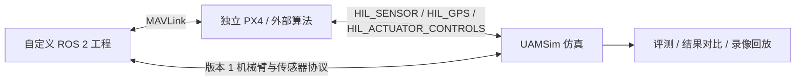

# 实验与接口契约

框架端不导入 `uam_bridge` 或 `rclpy`，不读取 PX4 源码、机型或构建目录。两个外部工程可以独立替换与版本管理。



## 实验配置版本 1

最小例子（不依赖 ROS/PX4，仅演示检查结果收集）：

```json
{
  "version": 1,
  "case_id": "example-case",
  "label": "candidate-a",
  "steps": [{
    "action": "check", "name": "acceptance",
    "command": ["${python}", "-c", "import json; print(json.dumps(dict(error_m=0.1)))"],
    "timeout": 30
  }],
  "metrics": {"error_m": {"check": "acceptance", "key": "error_m"}}
}
```

- `start`：启动服务，可指定 `ready_text` 等待日志就绪，超时失败；否则立即进入下一步。
- `check`：运行外部验收命令，非零退出失败。日志中每行 JSON 对象记录到结果；验收脚本负责根据标准返回退出码，不能仅打印 `passed=false` 后仍返回 0。
- `wait`：通过 `name` 等待此前启动的服务正常退出。持续服务若提前退出则失败。
- 每步可设 `cwd`、`env`、`timeout`；顶层 `env` 用于所有命令。
- 支持 `${framework}`（框架根目录）、`${config}`（配置所在目录）、`${output}`、`${python}` 四种替换。
- `metrics` 从指定 check 的 JSON 行提取最后出现的数值，缺失或非有限值导致实验失败。
- `artifacts` 是相对输出目录的文件索引；配置本身完整存入 `manifest.json`。外部源码版本可放入自定义 `provenance` 字段，框架会原样保存，不会声称自动核验外部版本。

输出包含 `manifest.json`、`summary.json` 与每个命令的日志。输出目录必须全新，防止覆盖实验。Linux 启动的命令使用独立进程组，实验结束或异常时停止自己创建的进程。Linux 记录并检查直接子进程与框架处于同一网络命名空间；配置不要用 Docker/SSH 启动跨容器节点。已在本机运行的外部程序无需列在 `start` 中，框架不会停止它们，也不负责检查其存活。

## 通信契约

| 通道 | 默认地址 | 数据与约定 |
| --- | --- | --- |
| 飞控 HIL | TCP 127.0.0.1:4560 | MAVLink 2 HIL_SENSOR、HIL_GPS、HIL_ACTUATOR_CONTROLS；可选依赖 pymavlink |
| 机械臂 | TCP 127.0.0.1:9211 | version=1 换行 JSON，最大 64 KiB；状态回传、关节位置命令 |
| 相机/雷达 | TCP 127.0.0.1:9212 | version=1 换行 JSON，最大 8 MiB；数组采用 base64 小端编码 |

框架物理坐标 NWU/FLU，PX4 NED/FRD，在 HIL 适配器统一转换；四元数 wxyz。旋翼顺序来自模型，归一化输出线性映射至模型每个旋翼的最大推力，解锁标志未置位则零推力。更换模型时外部飞控工程必须同步控制分配与推力参数。

机械臂 `joint_command` 字段为 version/type/epoch/sequence/names/position；位置单位 rad，必须包含完整关节集合，序号严格递增且 epoch 匹配本轮仿真。状态含 time、epoch、joints（names/position/velocity）。超时 0.5 秒转为保持测量位置。实现和校验见 `UAMSim/transport/protocol.py`，传感器字段与校验见 `sensor_protocol.py`。

ROS topic 名称、ROS 发行版、消息映射、CANopen 电机字典和 PX4 算法不属于框架契约。仓库中的 arm_server/sensor_server 是无 ROS 依赖的协议示例服务。
