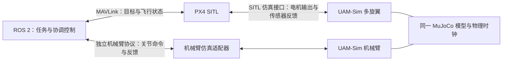

> 当前边界已更新：UAMSim 只负责验证对比，PX4 与 ROS 自定义包已拆为同级独立工程。以下为阶段历史，旧脚本路径请以 README 为准。

# UAM-Sim 分阶段实施记录

目标：在现有 MuJoCo 平台上借鉴本地 AM-Bench 的控制流程、任务与评测设计，
实现可重复实验、风与末端扰动、高级控制、多旋翼 PX4 SITL，
以及视觉/激光雷达等传感器类和 ROS 2 接入。
用户确认的仿真架构：ROS 2 通过 MAVLink 与 PX4 通信，PX4 通过 SITL
仿真接口控制 UAM-Sim 多旋翼；ROS 2 通过独立的机械臂协议与机械臂通信。
机械臂真机侧确认使用 CANopen；仿真侧已采用独立 TCP 命名关节协议。
用户最新确认硬件资料尚未确定，当前交付范围为仿真与驱动接口，设备适配后续进行。
不得将遥测 UDP 或 Offboard 目标发送等同于 SITL。

## 已确认的通信架构



- ROS 2 ↔ PX4：明确使用 MAVLink；其职责是任务目标、飞行指令及状态交换。
- PX4 ↔ UAM-Sim：独立的 SITL 仿真通信链路。仿真向 PX4 提供传感器数据与时间，
  接收电机输出，按示例线性推力模型施加于多旋翼。已基于 PX4 v1.16 源码核实
  MAVLink HIL_SENSOR/HIL_GPS/HIL_ACTUATOR_CONTROLS、TCP 及 lockstep；不是上层目标通道的替代。
- ROS 2 ↔ 机械臂：独立协议适配器负责关节命令和状态。真机后端使用 CANopen；
  仿真后端在命名关节/弧度语义层适配，不模拟 CANopen 设备或总线。
- PX4 模式下多旋翼执行器由 PX4 唯一控制，内置飞行控制器不同时写入。
  机械臂独立接收命令，但与多旋翼共享同一物理模型，保留动力学耦合。
- 网络/ROS 2 接收线程只更新有时间标记的缓冲；仿真线程统一在帧边界施加命令。
  已分别定义超时、陈旧命令和时间同步；每次外部联调新建独立回合，不支持运行中重置/重连。

## 阶段与验收

| 阶段 | 实施内容 | 验收门槛 | 状态 |
|---|---|---|---|
| 0 可靠基线 | 控制循环、错误传播、输出有效性、可发现回归测试 | 单帧单次控制；目标生效；异常不污染指令；启动失败可见；固定步数轨迹可重复 | 首批修复和基线测试通过 |
| 1 统一接口 | 状态/目标/命令契约；独立控制算法；实时与同步执行；统一重置 | 明确世界/机体坐标、四元数顺序、单位、控制周期；飞行与关节命令分别校验；旧接口可用 | 已实现首版契约、PID 与同步/配速执行器，相关测试通过 |
| 2 任务与评测 | 悬停、轨迹跟踪、臂运动稳姿；成功/失败/超时；配置与结果记录 | 按仿真时间批量运行；记录版本、配置、种子；误差和结束原因可追溯 | 首版任务、批量记录、汇总与命令回放已实现；轨迹跟踪基线尚未达标 |
| 3 风与末端扰动 | 风相对速度阻力、可重复阵风、末端外力/力矩 | 明确作用点与坐标系；无扰动等价性；力/力矩方向和反作用得到验证；配对实验 | 首版物理步扰动、10 项专项测试和 36 回合配对评测完成 |
| 4 高级控制 | 在统一接口上实现并比较进阶控制算法 | 使用相同任务/参数/扰动与 PID 对照；记录误差、饱和、计算时间及失败 | 几何姿态反馈与轨迹前馈已实现，72 回合对照完成 |
| 5 ROS 2、PX4 SITL 与机械臂协议 | ROS 2↔PX4 MAVLink；PX4↔仿真传感器/电机闭环；独立机械臂协议及 CANopen 驱动接口 | 实际 PX4 闭环飞行；机械臂独立控制/反馈；同一物理模型；超时与错误处理 | 纯飞行与带臂联合起飞/悬停/降落通过；CANopen 接口经模拟测试，设备适配按用户确认后续进行 |
| 6 视觉/激光雷达及 ROS 2 | 可配置传感器类、采样调度、图像/深度/扫描数据与 ROS 2 发布 | 已知场景图像/测距；帧名、外参、仿真时钟一致；实际 ROS 2 接收检查 | RGB/深度/内参/平面雷达/TF 在独立与联合场景均通过 ROS 2 订阅验收 |

部署位置按用户最新指示确定为已有 ROS-learning 对应容器 `ros2-learning`，
已检查为 Ubuntu 24.04 / ROS 2 Jazzy，`/opt/venv/bin/python` 可加载 rclpy 和所需消息。
按用户最新要求，已将完整工程、测试、PX4 v1.16 源码和 MuJoCo 环境迁到该容器；
PX4 在其中独立编译，全部运行时地址为 127.0.0.1，DDS 只在 localhost 发现。
Windows 仅编辑/同步文件，不再运行联调中的物理仿真。部署见 [本地环境](LOCAL_ROS2_ENVIRONMENT.md)。
机械臂联调见 [ROS2_INTEGRATION.md](ROS2_INTEGRATION.md)，
联合运行见 [PX4_SITL.md](PX4_SITL.md)。

CANopen 为用户确认的协议。电机型号、EDS/对象字典、支持的驱动模式、节点 ID、
减速比/编码器单位、物理 CAN 适配器型号尚未确定；CAN 发送软件侧确定为 ROS 2。
不可假定所有电机支持相同对象或模式。
可以先实现与设备无关的关节命令，再在接入阶段核对实际映射。

## 阶段 1 已实施的接口边界

- `ControlTarget` 表达世界位置、世界速度、偏航和可选关节位置目标。
- 控制器协议为 `reset(state)` 和 `compute(state, target, dt)`，`dt` 是实际控制周期，
  与 `RobotState.physics_dt` 区分。算法接收快照并返回 `RobotCommand`，不依赖线程。
- `CascadedPID` 提供位置/姿态积分、速度反馈、偏航误差环绕、旋翼分配及饱和诊断；
  限幅后冻结下一次积分，reset 清除积分和饱和状态。未提供新关节目标时保持回合初始位置。
- 默认增益针对当前示例六旋翼模型验证；只支持 Z-up 世界、向上平行旋翼和近悬停飞行，
  不适用于任意全驱动构型或大姿态机动。工厂方法会校验旋翼作用方向与分配矩阵秩。
- `ControlledSimulation` 接管未编译场景，单线程按整数物理步推进；默认每 5 个物理步
  更新一次控制。零配速尽快运行，正配速等待墙钟；两者共用相同控制与物理实现。
- reset 同时重置物理状态、执行器指令、控制器积分、缓存快照、帧数与最后命令。
  运行器拒绝跨线程访问；旧 `MujocoSimulation` 和控制器线程 API 保留。
  两种运行器应分别使用独立场景实例，不得让外部代码并发修改运行器公开的模型对象。
- 修正 `hover_thrust()`，使用当前机器人子树质量及场景重力，不计入其他场景物体的质量。

- `UAMSim.interfaces` 定义 Pose、JointState、RobotState、RotorCommand、
  JointPositionCommand、RobotCommand；上层使用米、秒、牛顿、弧度和弧度每秒。
- `Robot.read_state()` 在物理所有者线程生成独立快照，包含基座位姿、世界系线速度、
  机体系角速度、命名关节及可选末端位姿；四元数为 wxyz，表示机体到世界的旋转。
- 世界系是模型配置的坐标系；不将其自动视为 ENU/NED。ROS/PX4 坐标转换在适配层实现。
- `Robot.apply_command()` 先整体校验再写入，关节顺序可变但名称必须完整匹配。
  未指定的执行器组保持原指令；新接口拒绝越界命令，旧线程缓冲的裁剪行为保持不变。
- 新快照调用 `mj_forward` 刷新步进后的派生量，不推进时间；不得在控制器线程直接读取。
  速度使用 MuJoCo 的 [mj_objectVelocity 接口](https://mujoco.readthedocs.io/en/stable/APIreference/APIfunctions.html#mj-objectvelocity)，
  将旋转与平移分量分开转换，已通过旋转基座下的速度测试。

未来 ROS 2 的机械臂控制逻辑通过适配器选择 MuJoCo 或真实 CANopen 后端；
飞行链路始终遵循 ROS 2 → MAVLink → PX4 → SITL 仿真接口 → 多旋翼。
适配层负责仿真名称与真实关节名称映射、节点 ID、编码器刻度、减速比和设备状态；
控制算法不直接处理 CAN 帧。当前已实现关节位置仿真、ROS 2 节点和 CANopen 配置/驱动接口；
没有接入真实电机、速度/力矩模式或特定设备状态机。

### 阶段 1 验证

新增测试检查 100/200 Hz 控制周期、重复 reset 后的完整轨迹、实时配速前后轨迹一致性、
命令拒绝时不推进物理、控制饱和与积分重置、带臂爬升和机械臂周期运动。
带臂关节阶跃实验中，原示例增益的 2 秒位置误差约 0.414 m；调整横向位置增益和
姿态积分增益后约 0.107 m，通过 0.15 m 门槛。该比较仅针对当前模型及指定阶跃工况。
6 秒机械臂周期运动测试要求最大位置误差小于 0.25 m。

```sh
python -m examples.demo_controlled --arm
python -m examples.demo_controlled --arm --real-time-factor 1
```

示例输出固定步数、仿真时间、末态位置、位置 RMSE 和饱和步数。
这是单场景演示；通用任务评测使用下述阶段 2 入口。

## 阶段 2 任务与评测

`TaskConfig` / `FlightTask` 定义三类任务：hover（悬停）、tracking（平面正弦轨迹及
解析速度参考）、arm_motion（保持基座位置并使指定关节周期运动）。种子控制目标中心
的均匀扰动，默认各轴 ±0.05 m；此处没有宣称做初始物理状态或模型参数随机化。

- 每回合完整 reset，按仿真控制周期推进；时长必须是控制周期的整数倍。
- 成功：完成全时长，且最后连续 1 秒同时满足位置误差 ≤0.15 m、速度误差 ≤0.25 m/s、
  偏航误差 ≤0.15 rad、最大关节误差 ≤0.1 rad。阈值均可配置。
- 失败：机器人接触、低于最小高度、倾角过大、位置发散或运行错误；失败优先于成功。
- 超时：到达规定时长但未满足持续跟踪要求。不会因某一瞬间到达目标而提前成功。
- 物理接触和误差阈值按控制采样周期检查；尚不保证捕获两个控制采样间的瞬态事件。
- `trace.jsonl` 逐帧保存状态、施加的目标、采样时刻参考、实际命令、误差、结束原因、
  饱和标记与控制算法耗时。控制耗时不包含物理推进、文件写入和实时等待。
- `manifest.json` 保存任务配置、种子、解析后的目标中心、初始状态、控制增益、步长和
  Python/NumPy/MuJoCo 版本。批量入口额外复制三个示例模型，保存模型与源码 SHA256、
  Git revision 和 dirty 状态；没有把未提交源码打包为完整的软件环境。
- `summary.json` 保存每回合指标和分任务汇总，失败/超时回合都进入成功率分母。
  位置 RMSE 是各采样时刻三维位置误差范数的均方根，包含起始过渡；缺失指标为 null，
  不伪装成零误差。批量 RMSE 是有指标回合的等权平均，并注明有指标回合数。
- `step_command()` 允许运行器直接推进记录的执行器命令，不再运行控制算法。
  回放检查引擎版本、步长、帧序号、关节映射和整条位姿/速度轨迹；命令或参考轨迹
  被篡改时验证失败。CLI 还校验模型快照的哈希。

```sh
python -m examples.benchmark --seeds 0 1 2
# 使用上一步输出的目录替换 RUN_DIR
python -m examples.benchmark --replay RUN_DIR/006-pid-none-arm_motion-seed-0
```

2026-11-01 当前 PID 的首轮 9 回合基线（每回合 6 秒，均带机械臂）：

| 任务 | 成功 | 超时 | 平均回合位置 RMSE |
|---|---:|---:|---:|
| 悬停 | 3/3 | 0 | 0.0437 m |
| 轨迹跟踪 | 0/3 | 3 | 0.1065 m |
| 机械臂运动稳姿 | 3/3 | 0 | 0.0993 m |

轨迹跟踪未满足持续容差，保留为后续高级控制的对照，不能将评测工具通过等同于控制
性能达标。机械臂运动回合的 1200 步命令回放与原状态轨迹最大绝对误差为 0。

## 阶段 3 环境风与末端扰动

`WindConfig`、`EndEffectorWrench` 和 `DisturbanceConfig` 独立定义扰动；
`ControlledSimulation` 支持同步和配速两种方式，按每个物理步计算并施加扰动。
旧三线程 `MujocoSimulation` 尚未接入该配置，不应假定所有运行入口均支持扰动。

- 风速在世界系给定，阵风为各轴正弦波，其初相位由独立扰动种子确定；reset 可复现。
- 线性阻力：`F_body = C_body * R.T @ (wind_world - point_velocity_world)`，
  系数单位 N/(m/s)，力再旋转到世界系。作用点为可配置的基座局部坐标，点速度包含
  基座角速度引起的 `omega × offset`。零风速且非零阻力系数仍有空气阻尼。
- 末端外力和力矩可用世界系或末端 site 坐标表达，时间窗口为 `[start, end)`，
  力作用在末端 site 的实际位置；通过
  [MuJoCo mj_applyFT](https://mujoco.readthedocs.io/en/stable/APIreference/APIfunctions.html#mj-applyft)
  映射到关节广义力，保留对基座和机械臂的耦合影响。无需额外给基座施加一次反向力。
  这是外部环境施力模型，没有另建产生反作用的环境刚体。
- 只添加本模块的广义外力，每步后恢复原有外力数组，异常路径也恢复；不会覆盖其他来源。
- 关闭扰动或全部力系数为零时跳过额外动力学计算，轨迹逐值等于无扰动基线。
- 回合 manifest 保存扰动配置和种子，trace 保存最后一个物理子步的扰动采样及其时间；
  该采样时间早于控制更新后的状态时间一个物理步。回放重算每个物理步的扰动，
  配置/种子不匹配时拒绝验证。更改配置后必须 reset 才能继续推进。
- 目前使用可控的线性阻力和正弦阵风，尚未做真实气动参数辨识，也未实现地效、墙效或湍流模型。
  本阶段验证的是位姿/速度与外力作用，不是 PX4 IMU 传感器链路；后续 SITL 适配须单独
  验证外力作用下的比力、采样时序和传感器坐标系。

```sh
python -m examples.benchmark --disturbances none wind wrench combined --seeds 0 1 2
python -m examples.benchmark --replay RUN_DIR/033-pid-combined-arm_motion-seed-0
```

CLI 配对预设：风均值 (1,0,0) m/s、阵风幅值 (0.3,0.2,0) m/s、周期 2 s、
机体系阻力系数各轴 0.3 N/(m/s)；末端外力 (0.5,0,0) N 在第 1–3 秒施加，
无附加力矩。每组使用相同任务种子，summary 按扰动条件、任务分别汇总。

2026-11-01 共 36 回合（每条件/任务 3 回合，均 6 秒）：

| 条件 | 悬停 RMSE | 轨迹跟踪 RMSE | 机械臂稳姿 RMSE |
|---|---:|---:|---:|
| 无扰动 | 0.04370 m | 0.10647 m | 0.09927 m |
| 仅风 | 0.05215 m | 0.10746 m | 0.10087 m |
| 仅末端外力 | 0.05499 m | 0.11607 m | 0.10370 m |
| 叠加 | 0.06843 m | 0.11977 m | 0.11037 m |

四种条件的悬停、机械臂稳姿均为 3/3 成功；轨迹跟踪均为 0/3 成功、3/3 超时。
叠加扰动的机械臂运动回合 1200 步回放最大绝对状态误差为 0。全套 47 项测试通过。

## 阶段 4 几何控制与轨迹前馈

`GeometricController` 复用 PID 的模型参数检查与旋翼分配，但将姿态反馈改为旋转矩阵
误差，并使用目标加速度及有限差分的期望姿态角速度。旋转误差构造参考
[Lee、Leok、McClamroch 的几何控制论文](https://arxiv.org/abs/1003.2005)。
本实现使用向上推力坐标约定、限幅积分、倾角锥限制及不超过 4 rad/s 的期望角速度，
没有实现该文完整的刚体惯量前馈项，也不是全身 MPC 或带稳定性证明的完整论文复现。
不能据此声称支持倒飞恢复或任意大姿态机动。

- `ControlTarget.acceleration_world` 默认为零；tracking 任务提供解析加速度。
  PID 保持原行为，几何控制器使用该前馈项。比较反映整套控制方法差异，不能单独
  将收益归因于几何姿态误差。两者使用相同位置/速度目标、增益数值、分配矩阵及验收阈值。
- 期望旋转由目标合力方向和偏航构造；矩阵误差避免欧拉角反馈的表示问题，
  相反符号的同姿态四元数产生相同指令。目标历史和积分在 reset 中清除。
- 算法只读取公开状态与当前目标，不读取未来轨迹或真实扰动力。
- 测试涵盖四元数符号不变性、旋转正交性/行列式、倾角和角速度限制、历史重置、
  加速度导数一致性，以及叠加扰动下与 PID 的跟踪对照和命令回放。

```sh
python -m examples.benchmark --controllers pid geometric --disturbances none wind wrench combined --seeds 0 1 2
python -m examples.benchmark --replay RUN_DIR/066-geometric-combined-tracking-seed-0
```

summary 依次按控制器、扰动条件、任务分组。2026-11-01 共 72 回合，当前示例模型，
每回合 6 秒，以下为轨迹跟踪的三种子平均位置 RMSE：

| 条件 | PID | 几何控制 | PID 成功 | 几何控制成功 |
|---|---:|---:|---:|---:|
| 无扰动 | 0.10647 m | 0.07281 m | 0/3 | 3/3 |
| 仅风 | 0.10746 m | 0.07638 m | 0/3 | 3/3 |
| 仅末端外力 | 0.11608 m | 0.08134 m | 0/3 | 3/3 |
| 叠加 | 0.11977 m | 0.08917 m | 0/3 | 3/3 |

原 PID 最后一秒峰值速度误差约 0.474 m/s（无扰动 seed=0），未满足 0.25 m/s 门槛；
几何控制通过原门槛，没有放宽容差。所有任务合计：PID 24/36 成功，几何控制 36/36 成功。
本次测得控制计算均值 PID 约 0.076 ms、几何控制约 0.147 ms，均未出现指令饱和；
耗时受主机负载影响，不是硬实时保证。所查叠加扰动跟踪回合回放误差为 0。
全套 53 项测试通过；结论仅覆盖这些模型、目标和扰动幅度。

## 传感器边界与验收

视觉和激光雷达由仿真所有者采集，具有明确安装外参、采样周期、帧名和仿真时间戳；
ROS 2 适配器处理消息编码与发布，不在网络线程访问 mjData。RGB/深度图、平面扫描、
内参和 TF 已在用户现有 ROS-learning 容器实际订阅验收，另用已知 1.9 m 平面验证测距几何。
没有实现三维点云或多线雷达。细节见 [SENSORS_AND_DRIVERS.md](SENSORS_AND_DRIVERS.md)。

## 阶段 0 已实施

- 飞行和机械臂控制线程每帧只调用一次控制律，使用合并后的动态目标。
- 输出维度和有限值检查在任何缓冲写入之前完成；错误时保持完整上一条命令。
- 控制器暴露 `last_error` 和累计 `error_count`，恢复成功后清除当前错误。
- 单控制通道拒绝重复订阅。
- `wait_ready(timeout)` 超时返回 False；启动异常通过 RuntimeError 的 cause 传回。
- 仿真运行错误保存在 `sim.error`，触发共享停止事件，关闭控制通道。
- 缺失 MuJoCo 时报告失败，移除伪装为物理仿真的 clock-only 回退。
- 等待控制回执时收到停止信号，不再执行该物理步。
- 原有三个独立场景脚本纳入自动发现；新增固定步数与异常路径测试。

## 验证方式

在安装项目依赖的 Python 环境中，从仓库根目录执行：

```sh
python -m unittest discover -s tests -v
```

也可使用开发依赖中的 pytest。新增测试使用标准库 unittest，不需要额外安装测试器。
初版验证环境：Windows，Conda robotsim，MuJoCo 3.16.0；随后已在 ROS-learning 的 Linux 环境重跑完整回归。

固定步数基线：纯多旋翼分别运行 1500 步悬停、爬升和零推力下落，再 reset 后重复。
检查整条位置轨迹在绝对误差 1e-12 内一致、悬停高度误差小于 0.01 m、
爬升末态高于 1.9 m、下落末态低于 0.2 m。此结果仅证明该模型及环境的重复性。

原有场景测试是冒烟验证，不是整机性能达标证据：例如环境测试使用简单高度控制，
带臂时曾出现约 39 度滚转；Robot 示例存在横向漂移。阶段 1/2 将建立完整位置/姿态
控制和误差门槛。实时测试依赖墙钟调度；固定步数实验不依赖机器实时速度。

尚未验证 GUI、长时运行或真实 CANopen 设备。用户控制律若永久阻塞，当前
线程不能强制中断；后续外部控制通信需要有界等待与超时策略。

## PX4 SITL 首轮验收

早期在分开的 ROS/PX4 环境完成纯六旋翼
ROS 2 → MAVLink → PX4 → MuJoCo 的正常解锁、起飞、悬停、Land 和自动解除电机。
悬停末 3 秒估计位置误差最大约 0.06745 m，66 项回归通过。配置、坐标转换、
传感器噪声、测试记录及未覆盖项见 [PX4 SITL 指南](PX4_SITL.md)。
随后带臂与传感器联合验收通过：最大估计位置误差 0.08726 m、关节误差 0.0007663 rad，
正常自动降落；最终 75 项回归通过。所有当前仿真阶段和驱动接口已交付，
真实 CANopen 设备适配按用户最新确认留到型号与对象字典确定后。

## 同机迁移与录像

按最新要求，PX4 v1.16 源码与全部 UAMSim 模型、测试已搬入 `ros2-learning`，
在容器内独立构建 `px4_sitl_uamsim`，配置 MuJoCo 3.16、EGL/Mesa 与 FFmpeg。
ROS/PX4/MuJoCo/订阅程序共享网络命名空间，连接均为 localhost，不再跨容器运行。
75 项原有回归在 Linux 重新通过；加入录像后完整 79 项通过。

录像保存编译模型和每控制步完整 integration state，结束后离线输出第三人称 MP4 与
HTML 播放器；可定位时间、截取片段、调速或切换机载相机重新导出。
这类回放恢复已保存状态，不执行控制或物理积分；评测模块的指令重新仿真回放仍保留。
运行步骤见 [同机环境](LOCAL_ROS2_ENVIRONMENT.md) 和 [录像与回放](RECORDING_AND_REPLAY.md)。
